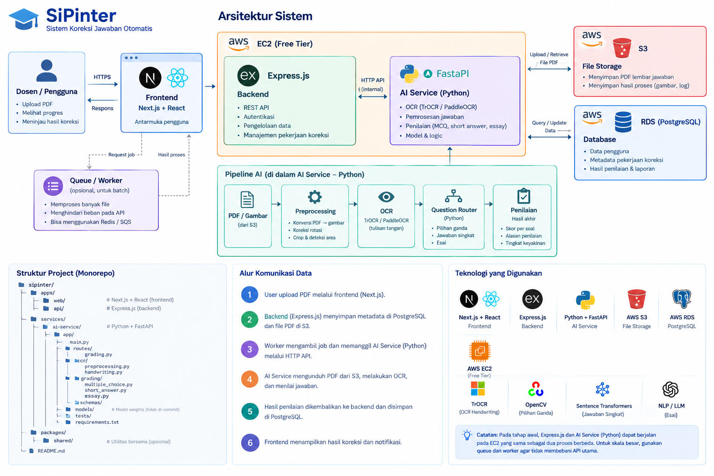

# Arsitektur Sistem SiPinter

SiPinter (**Sistem Koreksi Jawaban Otomatis**) membantu dosen mengoreksi lembar jawaban ujian mahasiswa. Dosen mengunggah PDF hasil scan lembar jawaban; sistem membaca tulisan tangan (OCR), menilai setiap jawaban sesuai kunci jawaban, lalu dosen meninjau dan memverifikasi hasilnya.

Dokumen ini menjelaskan arsitektur target, struktur repository, dan apa saja yang **sudah** maupun **belum** diimplementasikan. Cara menjalankan proyek ada di [Cara Menjalankan Proyek](how-to-run.html).

## Daftar isi

1. [Gambaran umum](#1-gambaran-umum)
2. [Komponen sistem](#2-komponen-sistem)
3. [Alur komunikasi data](#3-alur-komunikasi-data)
4. [Pipeline AI](#4-pipeline-ai)
5. [Struktur repository (monorepo)](#5-struktur-repository-monorepo)
6. [Backend (Express.js)](#6-backend-expressjs)
7. [Frontend (Next.js)](#7-frontend-nextjs)
8. [Database (PostgreSQL)](#8-database-postgresql)
9. [Keamanan](#9-keamanan)
10. [Deployment](#10-deployment)
11. [Status implementasi](#11-status-implementasi)

---

## 1. Gambaran umum



Ringkasnya:

```text
 Dosen (browser)
      │ HTTPS
      ▼
 ┌──────────────┐        ┌───────────────────────── AWS EC2 ─────────────────────────┐
 │  Frontend    │ /api/* │  ┌──────────────────┐  HTTP internal  ┌──────────────────┐ │
 │  Next.js     │───────▶│  │ Backend          │────────────────▶│ AI Service       │ │
 │  + React     │◀───────│  │ Express.js       │◀────────────────│ Python + FastAPI │ │
 └──────────────┘        │  └──────┬───────────┘                 └────────┬─────────┘ │
        ▲                └─────────┼──────────────────────────────────────┼───────────┘
        │                          │ query/update                         │ upload/ambil PDF
        │ hasil proses             ▼                                      ▼
 ┌──────┴───────────┐     ┌──────────────────┐                   ┌──────────────────┐
 │ Queue / Worker   │     │ AWS RDS          │                   │ AWS S3           │
 │ (opsional, batch)│     │ PostgreSQL       │                   │ File storage     │
 │ Redis / SQS      │     └──────────────────┘                   └──────────────────┘
 └──────────────────┘
```

Prinsip utama:

- **Browser hanya berbicara dengan satu origin.** Semua request `/api/*` diteruskan ke Express (oleh Next.js saat development, oleh Nginx saat produksi). Frontend tidak pernah terhubung langsung ke database, S3, atau AI service.
- **Backend adalah satu-satunya pemilik aturan bisnis**: autentikasi, otorisasi, validasi input, dan seluruh akses database.
- **Nilai dihitung di server** (oleh AI service), tidak pernah dikirim dari browser.
- **Pekerjaan berat dipisah dari API utama.** OCR dan penilaian berjalan di AI service; untuk skala besar dijalankan lewat queue/worker agar API tetap responsif.

## 2. Komponen sistem

| Komponen | Teknologi | Tanggung jawab | Status |
| --- | --- | --- | --- |
| **Frontend** | Next.js (App Router), React, TypeScript, Tailwind CSS, shadcn/ui | Antarmuka dosen: upload PDF, melihat progres, meninjau hasil koreksi | Sebagian (login/logout; halaman ujian masih placeholder) |
| **Backend** | Express.js, TypeScript, Zod, `pg` | REST API, autentikasi, pengelolaan data, manajemen pekerjaan koreksi | Sebagian (auth, user, ujian, soal, lembar jawaban, hasil) |
| **AI Service** | Python, FastAPI | OCR, pemrosesan jawaban, penilaian pilihan ganda/jawaban singkat/esai | Belum |
| **Queue / Worker** | Redis atau AWS SQS (opsional) | Memproses banyak file secara batch tanpa membebani API | Belum |
| **File storage** | AWS S3 | Menyimpan PDF lembar jawaban dan hasil proses (gambar, log) | Belum |
| **Database** | PostgreSQL di AWS RDS (lokal: Docker) | Data pengguna, metadata pekerjaan koreksi, hasil penilaian dan laporan | Sudah (skema, migrasi, seed) |
| **Reverse proxy** | Nginx | HTTPS dan routing ke Next.js / Express di produksi | Belum |

Teknologi AI yang direncanakan:

| Kebutuhan | Teknologi |
| --- | --- |
| OCR tulisan tangan | TrOCR / PaddleOCR |
| Deteksi pilihan ganda | OpenCV |
| Penilaian jawaban singkat | Sentence Transformers (kemiripan makna) |
| Penilaian esai | NLP / LLM |

> **Catatan:** pada tahap awal, Express.js dan AI service dapat berjalan pada EC2 yang sama sebagai dua proses berbeda. Untuk skala besar, gunakan queue dan worker agar tidak membebani API utama.

## 3. Alur komunikasi data

| # | Langkah | Status |
| --- | --- | --- |
| 1 | Dosen membuat ujian, soal, dan kunci jawaban, lalu mengunggah PDF lembar jawaban melalui frontend. | API ujian/soal/kunci **sudah**; halaman frontend dan upload PDF **belum** |
| 2 | Backend menyimpan metadata di PostgreSQL dan file PDF di S3. | Metadata lembar jawaban **sudah** (`POST /api/exams/:examId/answer-sheets`); S3 **belum** |
| 3 | Worker mengambil pekerjaan dan memanggil AI service melalui HTTP API. | Belum |
| 4 | AI service mengunduh PDF dari S3, menjalankan OCR, dan menilai jawaban. | Belum |
| 5 | Hasil penilaian dikembalikan ke backend dan disimpan di PostgreSQL (`answers`, `scores`). | Tabel **sudah**; endpoint internal untuk AI service **belum** |
| 6 | Frontend menampilkan hasil koreksi; dosen meninjau dan menandai lembar jawaban `verified`. | API **sudah** (`GET/PATCH /api/answer-sheets/:sheetId`); halaman frontend **belum** |

Status lembar jawaban (`verification_status`):

```text
 dibuat ──▶ pending ──(AI menilai, score terisi)──▶ dosen meninjau ──▶ verified
                ▲                                                         │
                └─────────────── dosen membuka kembali ───────────────────┘
```

Lembar jawaban hanya bisa `verified` jika sudah memiliki nilai.

## 4. Pipeline AI

Berjalan di dalam AI service (Python):

```text
PDF / gambar ─▶ Preprocessing ─▶ OCR ─▶ Question Router ─▶ Penilaian
  (dari S3)      • PDF → gambar    TrOCR /    • pilihan ganda     • skor per soal
                 • koreksi rotasi  PaddleOCR  • jawaban singkat   • alasan penilaian
                 • crop & deteksi  (tulisan   • esai              • tingkat keyakinan
                   area jawaban     tangan)
```

Question Router memilih grader berdasarkan `question_type` di database: `multiple_choice`, `short_answer`, atau `essay`. Nilai ini dijaga oleh `CHECK` constraint di migrasi `0003`.

## 5. Struktur repository (monorepo)

Proyek memakai **npm workspaces**: satu repository, beberapa aplikasi, masing-masing dengan `package.json` sendiri.

```text
SiPinter/
├── apps/
│   ├── web/                          # Frontend Next.js
│   │   └── src/
│   │       ├── app/                  # Routing App Router
│   │       │   ├── (public)/         # Halaman publik (beranda)
│   │       │   ├── (auth)/           # login, register (info: akun dibuat admin)
│   │       │   └── (dashboard)/      # dashboard, exams, questions, answer-sheets, results
│   │       ├── components/           # ui/ (shadcn), layout/ (sidebar), shared/
│   │       ├── features/             # Kode per fitur: auth, exams, questions, answer-sheets, ...
│   │       ├── config/               # Konfigurasi situs
│   │       └── lib/                  # api-client.ts (satu-satunya pintu ke API), utils
│   │
│   └── api/                          # Backend Express.js
│       ├── src/
│       │   ├── app.ts                # Merangkai middleware dan routes
│       │   ├── server.ts             # Titik masuk: baca env, buat pool DB, listen
│       │   ├── config/               # env.ts (validasi env), database.ts (pool, transaksi)
│       │   ├── middlewares/          # auth, validate, origin-check, error-handler
│       │   ├── lib/                  # http-error, cookies, rate-limiter, pg-errors, schemas
│       │   ├── modules/              # Satu folder per domain (lihat bagian 6)
│       │   └── db/                   # Runner migrasi & seed, CLI pembuatan user
│       ├── tests/                    # Unit + integration test (Vitest, Supertest)
│       ├── postman/                  # Koleksi Postman
│       └── API.md                    # Dokumentasi endpoint
│
├── services/                         # (rencana) Layanan non-Node
│   └── ai-service/                   # Python + FastAPI
│       ├── app/
│       │   ├── main.py
│       │   ├── routes/grading.py
│       │   ├── ocr/                  # preprocessing.py, handwriting.py
│       │   ├── grading/              # multiple_choice.py, short_answer.py, essay.py
│       │   └── schemas/
│       ├── models/                   # Bobot model (tidak di-commit)
│       ├── tests/
│       └── requirements.txt
│
├── packages/shared/                  # (opsional) Tipe/skema bersama
├── database/
│   ├── migrations/                   # 0001_*.sql, 0002_*.sql, ... (berurutan, tidak diubah setelah diterapkan)
│   ├── seeds/                        # Data contoh development/test
│   └── dev/init/                     # Skrip awal container Postgres lokal (membuat sipinter_test)
├── deploy/
│   ├── scripts/                      # create-app-user.sql (user DB least-privilege untuk RDS)
│   └── nginx/                        # (rencana) Konfigurasi Nginx
├── docs/                             # Situs dokumentasi (GitHub Pages / Jekyll)
├── docker-compose.dev.yml            # PostgreSQL lokal, khusus development
├── package.json                      # Workspaces + script root (dev, test, db:*)
├── .env.example                      # Contoh konfigurasi (placeholder saja)
└── README.md
```

Folder bertanda *(rencana)* belum dibuat.

## 6. Backend (Express.js)

### Modul

Kode dikelompokkan per domain di `apps/api/src/modules/`:

| Modul | Endpoint | Isi |
| --- | --- | --- |
| `health` | `/api/health`, `/api/health/db` | Cek API hidup dan koneksi database |
| `auth` | `/api/auth/login`, `/logout`, `/me` | Login, sesi, hashing password |
| `users` | `/api/users` | Manajemen akun (admin saja) |
| `students` | `/api/students` | Daftar mahasiswa (baca saja) |
| `exams` | `/api/exams` | CRUD ujian + aturan kepemilikan |
| `questions` | `/api/exams/:examId/questions` | CRUD soal + kunci jawaban |
| `answer-sheets` | `/api/exams/:examId/answer-sheets`, `/api/answer-sheets` | Lembar jawaban, jawaban, nilai, verifikasi |

Detail setiap endpoint: [`apps/api/API.md`](https://github.com/IlkhamAbdillah/SiPinter/blob/main/apps/api/API.md).

### Lapisan di dalam modul

Setiap modul memakai lapisan berikut, hanya bila memang dibutuhkan:

| File | Tugas |
| --- | --- |
| `*.routes.ts` | Mendefinisikan endpoint, memasang middleware, memanggil service/repository, membentuk respons |
| `*.schema.ts` | Skema Zod untuk validasi body, parameter path, dan query |
| `*.service.ts` | Aturan bisnis: cek akses, transaksi, menerjemahkan error database menjadi error HTTP |
| `*.repository.ts` | Query SQL berparameter (`$1`, `$2`, ...) dengan `pg`, tanpa ORM |
| `*.types.ts` | Tipe TypeScript dan daftar nilai yang diizinkan |

### Perjalanan satu request

Contoh `POST /api/exams/1/questions`:

```text
request
  │
  ├─ helmet ............... header keamanan HTTP
  ├─ cors ................. hanya jika CORS_ORIGINS diisi
  ├─ originCheck .......... tolak POST/PATCH/DELETE dari origin asing (CSRF)
  ├─ express.json ......... parse body JSON (maks. 1 MB)
  ├─ requireAuth .......... baca cookie sesi → cari di tabel sessions → res.locals.user (atau 401)
  ├─ validate ............. cek params & body dengan Zod (atau 400 VALIDATION_ERROR)
  ├─ handler
  │    ├─ getAccessibleExam ... ujian ada & milik user (atau admin)? jika tidak → 404
  │    └─ createQuestion ...... transaksi: INSERT soal + INSERT kunci jawaban
  └─ errorHandler ......... semua error → { "error": { code, message } }, tanpa detail SQL
```

Format respons selalu sama: sukses `{ "data": ... }`, gagal `{ "error": { "code", "message", "details"? } }`.

## 7. Frontend (Next.js)

- **App Router dengan route group**: `(public)`, `(auth)`, `(dashboard)`. Layout `(dashboard)` memanggil `getCurrentUser()` di server; jika belum login, pengguna diarahkan ke `/login`.
- **`lib/api-client.ts`** adalah satu-satunya tempat frontend memanggil API. Di browser, request menuju origin yang sama (`/api/...`); di server (Server Components), request langsung ke `API_INTERNAL_URL`.
- **`features/<nama>/`** berisi komponen, skema, dan tipe khusus fitur tersebut, agar halaman di `app/` tetap tipis.
- **Rewrite** di `next.config.ts` meneruskan `/api/*` ke Express saat development, sehingga cookie sesi tetap first-party dan CORS tidak diperlukan.

Saat ini halaman login/logout sudah terhubung ke API. Halaman dashboard, ujian, soal, lembar jawaban, dan hasil masih berupa tampilan statis yang belum memanggil API.

## 8. Database (PostgreSQL)

### Relasi tabel

```text
users (dosen/admin) 1 ──< exams 1 ──< questions 1 ──1 answer_keys
         │                  │              │
         │                  │              └──< answers >── answer_sheets
         │                  └──< answer_sheets >── students
         │                              │
         │                              └── 1 : 1 ── scores
         └──< sessions
```

| Tabel | Isi | Relasi penting |
| --- | --- | --- |
| `users` | Akun dosen dan admin (password berupa hash scrypt) | `role` ∈ `lecturer`, `admin` |
| `sessions` | Sesi login (hanya hash SHA-256 token) | milik satu `users` |
| `students` | Data mahasiswa (NIM sebagai `student_id`) | mahasiswa **tidak** login |
| `exams` | Ujian | milik satu dosen |
| `questions` | Soal | nomor soal unik per ujian |
| `answer_keys` | Kunci jawaban + kata kunci | satu per soal |
| `answer_sheets` | Lembar jawaban satu mahasiswa untuk satu ujian | unik per (ujian, mahasiswa); `file_path` = lokasi PDF |
| `answers` | Jawaban per soal | unik per (lembar jawaban, soal) |
| `scores` | Nilai akhir 0–100 | satu per lembar jawaban |

Semua foreign key memakai `ON DELETE CASCADE`: menghapus ujian ikut menghapus soal, kunci, lembar jawaban, jawaban, dan nilainya.

### Migrasi dan seed

| File | Isi |
| --- | --- |
| `database/migrations/0001_initial_schema.sql` | Skema awal semua tabel, constraint, dan index |
| `database/migrations/0002_auth_sessions.sql` | Constraint role & email, tabel `sessions` |
| `database/migrations/0003_question_types_and_sheet_status.sql` | Nilai yang diizinkan untuk `question_type` dan `verification_status` |
| `database/seeds/0001_dev_data.sql` | 3 akun, 10 mahasiswa, 3 ujian, 15 soal + kunci, 6 lembar jawaban + jawaban + nilai |

- Migrasi dijalankan berurutan, masing-masing dalam satu transaksi, dan dicatat di tabel `schema_migrations` beserta checksum. **File migrasi yang sudah diterapkan tidak boleh diubah**; perubahan skema selalu lewat file baru.
- Seed mengosongkan tabel lalu mengisi ulang data contoh, dan menolak berjalan di produksi atau di AWS RDS.

## 9. Keamanan

| Aspek | Implementasi |
| --- | --- |
| Password | Hash **scrypt** (bawaan Node.js) dengan salt acak; hash tidak pernah dikirim ke client |
| Sesi | Token acak 256-bit di cookie `HttpOnly`, `SameSite=Lax` (produksi: `Secure` + prefix `__Host-`); database hanya menyimpan hash token; kedaluwarsa 12 jam; logout menghapus sesi di server |
| Otorisasi | Dicek di API untuk setiap request: `requireAuth`, `requireRole`, dan cek kepemilikan ujian. Data milik dosen lain dijawab `404` |
| CSRF | `SameSite=Lax` + cek header `Origin` + hanya menerima body JSON |
| Brute force | Batas percobaan login per IP dan per (IP, email) |
| SQL injection | Semua query berparameter; tidak ada penggabungan string dari input pengguna |
| Validasi | Semua input divalidasi Zod di server |
| Kebocoran error | Error tak terduga hanya `500 INTERNAL_ERROR`; detail hanya di log server |
| Secret | Tidak di-commit; `.env.example` hanya berisi placeholder |
| Database | User aplikasi least-privilege (`deploy/scripts/create-app-user.sql`), TLS `verify-full` ke RDS, RDS di subnet privat |
| Komunikasi antarlayanan *(rencana)* | AI service dan worker memakai token internal, bukan sesi pengguna |

## 10. Deployment

Target produksi (belum diimplementasikan):

```text
Internet ─HTTPS─▶ Nginx (EC2) ─┬─ /      ─▶ Next.js
                               └─ /api/* ─▶ Express ──▶ AI Service (proses terpisah, port internal)
                                               │
                                               ├──▶ AWS RDS (subnet privat, hanya dari security group backend)
                                               └──▶ AWS S3
```

- Aplikasi dijalankan dengan Docker Compose produksi (Next.js, Express, AI service, Nginx). **PostgreSQL tidak dijalankan sebagai container di produksi**; memakai AWS RDS.
- `docker-compose.dev.yml` hanya untuk database lokal saat development.
- Konfigurasi development dan produksi dipisah (`NODE_ENV=production` mewajibkan TLS database dan `APP_ORIGIN`).

## 11. Status implementasi

| Fase | Isi | Status |
| --- | --- | --- |
| 1 | Fondasi repository (workspaces, TypeScript, lint, test) | Selesai |
| 2 | Integrasi database (pool `pg`, TLS RDS, user least-privilege) | Selesai |
| 3 | Manajemen skema (migrasi, seed) | Selesai |
| 4 | Fondasi API (env, error handling, health check) | Selesai |
| 5 | Autentikasi & otorisasi | Selesai |
| 6 | API inti: ujian, soal, kunci jawaban, lembar jawaban, hasil | Selesai (tanpa upload S3 dan endpoint untuk AI service) |
| 7 | Fondasi frontend (layout, API client, login) | Sebagian |
| 8 | Fitur frontend (ujian, soal, lembar jawaban, hasil) | Belum |
| – | AI service (FastAPI), S3, queue/worker | Belum |
| 9 | Integration & end-to-end testing | Belum |
| 10 | Deployment (Docker, Nginx, HTTPS, backup) | Belum |

[Kembali ke beranda](../index.html)
